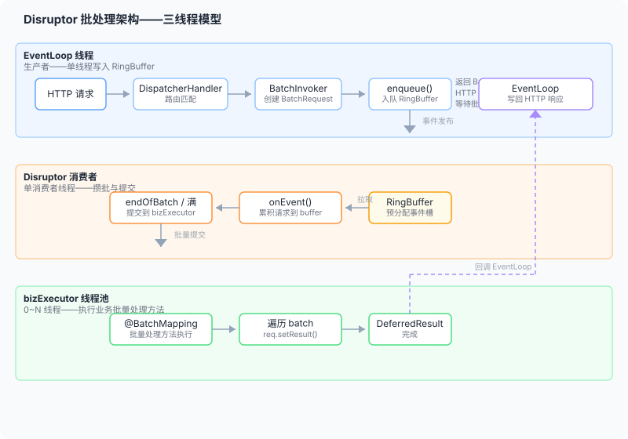

> [English](en/batch.md) | 中文

# Batch 批处理模块

`spring-web-batch` 将高并发的独立请求透明聚合为批量，由批量处理方法一次处理完所有请求，适合 IO 密集型场景（批量 DB 查询、批量 RPC 调用）。

基于 **LMAX Disruptor** 实现无锁环形缓冲区，提供背压策略、等待策略、线程池隔离等生产级特性。

---

## 目录

- [快速开始](#快速开始)
- [@BatchMapping 注解](#batchmapping-注解)
- [架构设计](#架构设计)
  - [攒批机制与批大小](#攒批机制与批大小)
- [可观测性](#可观测性)
- [配置参考](#配置参考)
- [注意事项](#注意事项)

---

## 快速开始

### 1. 添加依赖

```xml
<dependency>
    <groupId>io.github.springperf</groupId>
    <artifactId>spring-web-batch</artifactId>
    <version>${spring-web.version}</version>
</dependency>
```

`spring-boot-starter-web` 中 `spring-web-batch` 声明为 `<scope>provided</scope>`，即使使用了 starter 也需要单独添加。

### 2. 编写 Controller

**第 1 步：定义单请求端点**

将普通 Controller 方法的返回值类型改为 `BatchRequest<R>`（即 `DeferredResult` 的子类），方法体不会实际执行：

```java
@RestController
@RequestMapping("/api")
public class UserController {

    @GetMapping("/users/{id}")
    public BatchRequest<UserResp> getUser(@PathVariable Long id,
                                          @RequestParam(defaultValue = "zh") String lang) {
        // 方法体不会执行，由 BatchInvoker 接管
        return null;
    }
}
```

**第 2 步：定义 BatchRequest 子类**

构造函数参数类型必须与单方法参数类型**按序一致**：

```java
public class GetUserRequest extends BatchRequest<UserResp> {

    private final Long id;
    private final String lang;

    public GetUserRequest(Long id, String lang) {
        this.id = id;
        this.lang = lang;
    }

    public Long getId() { return id; }
    public String getLang() { return lang; }
}
```

**第 3 步：编写批量处理方法**

在同一个 Controller 中编写 `@BatchMapping` 方法：

```java
@RestController
@RequestMapping("/api")
public class UserController {

    // ... 单请求端点

    @BatchMapping(method = "getUser")
    public void batchGetUser(List<GetUserRequest> batch) {
        Map<Long, UserResp> dbResult = userService.batchQuery(batch);
        for (GetUserRequest req : batch) {
            UserResp resp = dbResult.get(req.getId());
            req.setResult(resp != null ? resp : new UserResp());
        }
    }
}
```

- `@BatchMapping(method = "getUser")` 关联到单请求端点 `getUser`
- **唯一参数**必须为 `List<? extends BatchRequest<?>>`，即待处理的批量请求
- 处理完成后调用 `BatchRequest.setResult()` 完成每个请求的 HTTP 响应

---

## @BatchMapping 注解

```java
@Target(ElementType.METHOD)
@Retention(RetentionPolicy.RUNTIME)
@Documented
public @interface BatchMapping {

    int ringBufferSize() default 4096;
    WaitStrategy waitStrategy() default WaitStrategy.BLOCKING;
    Backpressure backpressure() default Backpressure.BLOCK;
    String method() default "";
    int maxBatchSize() default 100;
    int batchWindowMillis() default 5;
    int consumerSize() default -1;

    enum WaitStrategy { YIELDING, BLOCKING, SLEEPING, BUSY_SPIN }
    enum Backpressure { BLOCK, DROP, THROW }
}
```

### 参数说明

| 参数 | 默认值 | 说明 |
|------|--------|------|
| `ringBufferSize` | 4096 | Disruptor 环形缓冲区容量，自动归一化为 2 的 N 次幂 |
| `waitStrategy` | BLOCKING | 消费者等待策略，见下方表格 |
| `backpressure` | BLOCK | 背压策略，见下方表格 |
| `method` | "" | 被关联的单请求方法名，默认与批量处理方法同名 |
| `maxBatchSize` | 100 | 单次批处理最大请求数，达到该值触发批量处理 |
| `batchWindowMillis` | 5 | 攒批时间窗口（毫秒），0 = 显式关闭。**默认开启**，批大小由窗口保证而非依赖 RingBuffer 瞬时积压；低负载 + 极快 IO（< 5ms）可设 0 或 2~3ms，见[攒批机制与批大小](#攒批机制与批大小) |
| `consumerSize` | -1 | 业务线程池（bizExecutor）最大并发处理线程数，默认 CPU 核数；Disruptor 消费者线程独立，**不占该配额**。开启虚拟线程（JDK 21+）后执行线程改为虚拟线程，配额语义不变；此时建议保持 `waitStrategy=BLOCKING`——`BUSY_SPIN`/`YIELDING` 不会卸载虚拟线程，会长期占住载体线程 |

### 背压策略

| 策略 | 行为 | 客户端响应 |
|------|------|-----------|
| `BLOCK` | 生产者线程（业务池或 EventLoop）阻塞直到 RingBuffer 有空间 | 请求挂起，等待处理 |
| `DROP` | 丢弃请求，`BatchRequest` 收到 `BatchOverflowException` | **429 Too Many Requests** |
| `THROW` | 同步抛出 `BatchOverflowException` | **429 Too Many Requests** |

### 等待策略

| 策略 | 适用场景 | CPU 消耗 | 延迟 |
|------|---------|---------|------|
| `BLOCKING` | 空闲时段较多，省 CPU | 低 | 高 |
| `YIELDING` | 低延迟、中等吞吐 | 中 | 中 |
| `SLEEPING` | 省 CPU 但需要一定响应速度 | 低 | 中高 |
| `BUSY_SPIN` | 极致低延迟、高吞吐 | 高（始终占满 CPU） | 低 |

### 线程模型

`@BatchMapping` 为每个方法创建独立的 Disruptor 队列，内部线程模型：

```
调度线程（生产者：默认业务池；开虚拟线程时为 EventLoop）
    ↓ 入队 RingBuffer
Disruptor 消费者线程（1 个）
    ↓ 攒批 → 提交
bizExecutor 线程池（0 ~ consumerSize 个；开虚拟线程时为虚拟线程）
    ↓ 执行
@BatchMapping 方法
```

- **生产者**：由默认线程模型决定——不开启虚拟线程时是 `default` 业务线程池（遵循 `pool.default-execute-mode`）；**开启虚拟线程（JDK 21+）时改为 EventLoop 直投**（`BatchRegistry` 会把 default 池置空，避免多一次线程切换）。两种情况下都只是调用 `BatchInvoker` 入队（微秒级、不阻塞），无需 `@RunInPool`
- **消费者**：Disruptor 单消费者线程不断从 RingBuffer 拉取事件
- **业务线程池**：0 核心线程、`SynchronousQueue`、`CallerRunsPolicy`——空闲时零线程占用，满负荷时消费者线程自行执行形成背压。开启虚拟线程（`spring.threads.virtual.enabled=true`，JDK 21+）时执行线程改为**虚拟线程**（上限与背压语义不变：仍受 `consumerSize` 限制），阻塞只挂起虚拟线程而不占用平台线程

### 攒批机制与批大小

**批处理模块的收益完全取决于批大小**：一次批量 IO 替代 N 次单条 IO，N 越大，消除的 IO 越多。默认开启 5ms 攒批窗口就是为了保证批大小；若显式设为 0，批大小会回落到 RingBuffer 瞬时积压的水平，`maxBatchSize=100` 很难达到。原因在于攒批的触发方式：

`BufferingBatchHandler` 把每批请求提交到 bizExecutor 时走的是 `executor.execute()`——**异步提交，IO 在业务线程上执行，不阻塞 Disruptor 消费者线程**。而消费者处理一个事件只是把请求加入 buffer（纳秒级），因此它几乎总能追上空队列；Disruptor 的 `endOfBatch` 信号在「没有更多可用事件」时置位，于是消费者每拿到 1 个事件就落盘一批。

> 换句话说（**仅限显式关闭窗口时**）：批大小不是由 `maxBatchSize` 决定的，而是由「消费者处理一个事件期间生产者发布了多少个新事件」决定的。在 IO 主导的场景里，这个数通常接近 1。

消费者唯一会被阻塞的时刻，是 bizExecutor 满员、`CallerRunsPolicy` 让消费者线程自己执行 IO。只有那时 RingBuffer 才会积压、批大小才会冲高。这带来一个反直觉的后果：**`consumerSize` 与批大小直接对冲**——并行度调大，消费更快，积压更少，批大小更小。

| 配置（100ms IO，并发 100，窗口精度修复前实测，用于说明机制） | 批大小 | 每请求 IO 成本 | QPS |
|---|---|---|---|
| `consumerSize=8`（合理并行度） | 2.8 | 106.5ms → 38.2ms（2.8x） | 632 |
| `consumerSize=1`（牺牲并行度） | 35.2 | 106.5ms → 3.1ms（34x） | 458 |
| `consumerSize=8` + `batchWindowMillis=5` | 17.8 | 106.5ms → 6.1ms（17x） | 611 |

**默认已启用时间窗口。** `batchWindowMillis > 0`（默认 5ms）时，本批第一个事件到达即启动窗口，期间继续累积，直到「攒满 `maxBatchSize`」或「窗口到期」才刷出。这样批大小由配置保证，不再依赖业务池偶然饱和；`consumerSize` 用于复用多核（取核数级别即可，不应超配），两者不再互斥。显式设为 0 才回到上面的 `endOfBatch` 路径。

窗口的代价是每个批次最多多等一个窗口，即单请求延迟上界约等于窗口值。默认值 5ms 来自窗口调度精度修复后的参数扫描
（closed model，并发 100，`consumerSize=8`，`maxBatchSize=100`，下游 IO 5 / 10 / 20 / 50ms）：四档吞吐分别为不开窗口的
**1.30x / 2.14x / 1.71x / 1.54x**，批大小 64~100，IO 次数降 4~5 倍，p50 / p99 同步下降。低负载（并发 1~4）时
按平均延迟（并发 / QPS）计算约 +0~6ms，属于纯等待成本。

| IO 延迟 / 负载 | 建议窗口 | 说明 |
|---|---|---|
| 常规 DB / RPC（≥ 5ms），中高并发 | 5（默认） | 收益已完全兑现，无需调参 |
| 低负载 + 极快 IO（< 5ms） | 0 或 2~3ms | 等待成本占比高，实测并发 4 / 5ms IO 下吞吐低于关窗 |
| 慢 IO（> 50ms） | 5，或按需上调后压测 | 5ms 已能攒满 `maxBatchSize`；加大窗口的收益不稳定，先压测 |
| 极致低延迟 | 0（显式关闭） | 单请求也要等满窗口，延迟敏感场景主动关闭 |

> **关于 10ms 档**：部分平台（如 Windows 上的 `Object.wait(10)`）会把 10ms 窗口量化到约 15ms，实测吞吐明显低于
> 5ms（10ms IO 档 0.93x vs 2.14x）。需要更大窗口时建议跳到 25ms 并自行压测，不要停在 10ms。

显式把 `batchWindowMillis` 设为 0 时，启动期会为每个关闭窗口的队列打一条 WARN（列出队列名），提示该队列的批大小
取决于 RingBuffer 瞬时积压、`maxBatchSize` 很难达到。未声明该参数的队列使用默认 5ms，不会再被告警；需要旧行为
可显式写 `batchWindowMillis = 0`。

#### 收益与成本的定量结论

以下数据来自窗口调度精度修复后的参数扫描（closed model，JDK 17，`consumerSize=8`，`maxBatchSize=100`，
并发 1 / 4 / 100，下游 IO 5 / 10 / 20 / 50ms）。绝对值受机器与负载模型影响，重点看相对趋势。

**高并发（并发 100）——默认 5ms 稳定优于不开窗口**：

| IO 延迟 | W=0 QPS | W=3 | W=5（默认） | W=10 | W=25 | W=5 批大小 / IO 次数 |
|---|---|---|---|---|---|---|
| 5ms | 3176 | 1.32x | **1.30x** | — | — | 64.1 / 194（W0：11.4 / 837） |
| 10ms | 3001 | 1.44x | **2.14x** | 0.93x | — | 100 / 193（W0：9.0 / 1002） |
| 20ms | 1693 | 1.57x | **1.71x** | 1.11x | — | 68.0 / 128（W0：10.0 / 510） |
| 50ms | 1061 | 1.37x | **1.54x** | 1.23x | 1.51x | 100 / 49（W0：12.3 / 258） |

收益来自「批量消除 IO」：IO 次数普遍降 4~5 倍，p50 / p99 同步下降（20ms 档 p99 206 → 48ms）。W=3 与 W=5 的差别
已接近基线噪声，但 W=5 在 10 / 20 / 50ms 三档都更高，故取 5 为默认值；W=10 明显回落，主要受平台定时粒度量化影响。

**低负载（并发 1~4）——等待是纯成本**：稀疏流量下第一个请求排完窗口任务后没有第二个请求来摊薄，只能等窗口到期。
并发 1 / 10ms IO 下 W=5 的 QPS 约为关窗的 0.84x、p50 16 → 30ms（直方图分桶约 16ms 一档，与平均延迟口径不同）；并发 4 / 5ms IO 下约 0.76x。
但慢 IO 档仍可能持平或略优（并发 4 / 50ms IO，W=5 为 1.05x）。这类场景建议显式设 0 或 2~3ms。

#### 结论：该不该保留默认窗口

| 目标 | 建议 |
|------|------|
| 降低数据库 / 下游压力 | **保持默认 5ms**。IO 次数确定下降，与 IO 延迟无关 |
| 中高并发 + IO ≥ 10ms 提升吞吐 | **保持默认 5ms**，收益最明显 |
| 低负载 + 极快 IO（< 5ms） | 显式设 0 或 2~3ms |
| 极致低延迟 | 显式设 0 |
| 想加大窗口到 10ms 以上 | 先压测；5ms 通常已攒满 `maxBatchSize`，10ms 档在部分平台会被量化放大 |

---

## 架构设计

### 请求流转

<p align="center">

</p>

### 核心组件

| 类 | 职责 |
|------|------|
| `BatchRequest<R>` | 继承 `DeferredResult<R>`，用户扩展的请求基类，通过构造参数位置匹配接收方法参数 |
| `@BatchMapping` | 标注在批量处理方法上，关联对应的单请求方法 |
| `BatchRegistry` | 管理所有 RingBuffer 生命周期（初始化/销毁），安装 `BatchInvoker` |
| `BatchInvoker` | 替换原 Controller 方法调用，直接根据构造参数创建 `BatchRequest` 实例并入队 |
| `DisruptorQueue` | 封装 LMAX Disruptor，提供入队/背压/关闭等操作 |
| `BufferingBatchHandler` | Disruptor 消费者，攒批达到阈值后提交到业务线程池 |

### 为什么用 Disruptor

- **无锁并发**：`ProducerType.MULTI` 支持多个 EventLoop 线程同时入队，无锁竞争
- **预分配事件槽**：`BatchEvent` 在 RingBuffer 中预创建，减少 GC 压力
- **endOfBatch 信号**：Disruptor 在批量发布结束时通知消费者，减少攒批延迟
- **背压自然**：生产者写入 RingBuffer 时，RingBuffer 满 → 生产者线程阻塞（业务池线程，或开虚拟线程时的 EventLoop）→ 请求等待、连接反压

---

## 可观测性

### Metrics 指标

`BatchMetrics` 是指标 SPI，框架默认实现为 `NoOpBatchMetrics`（全 no-op）。当
`io.micrometer.core.instrument.MeterRegistry` 在类路径上时（如通过 `spring-boot-starter-actuator` 引入），
**starter**（`SpringWebBatchAutoConfiguration` 内嵌的 `MicrometerBatchMetricsConfiguration`）会注册
`MicrometerBatchMetrics` 并经 `BatchRegistry#setMetrics(...)` 注入，产出以下指标：

| 指标名 | 类型 | Tag | 说明 |
|--------|------|-----|------|
| `batch.enqueue.total` | Counter | `queue` | 总入队尝试数 |
| `batch.enqueue.rejected` | Counter | `queue` | 停机期入队被拒数（`total` 中未成功的部分；DROP / THROW 的溢出另计入 `dropped` / `overflow`） |
| `batch.enqueue.dropped` | Counter | `queue` | 背压丢弃数 |
| `batch.enqueue.overflow` | Counter | `queue` | 溢出异常数 |
| `batch.process.duration` | Timer | `queue` + `outcome=success/failure` | 批处理耗时（成败分序列，避免失败批次污染分位数） |
| `batch.process.batch.size` | DistributionSummary | `queue` | 批大小分布 |
| `batch.process.requests` | Counter | `queue` | 请求完成数（仅统计批量方法正常返回的批次） |
| `batch.queue.remaining` | Gauge | `queue` | RingBuffer 剩余容量（见下方采样时机） |
| `batch.queue.capacity` | Gauge | `queue` | RingBuffer 总容量 |

所有指标均带有 `queue` Tag，值为 `batch:<ClassName>.<methodName>`（由 `BatchScanner` 生成）。

> **容量 Gauge 的采样时机**：队列启动时预热上报一次（Gauge 首次注册落在启动阶段，不进请求路径），之后每批处理结束刷新一次；当 RingBuffer 满导致 DROP / THROW 入队失败时立即补报一次。
> 采样不依赖额外线程，也不会在正常入队路径上产生额外开销。因此它是「水位」而非「实时读数」—— 批次停止产生时数值会停在最后一次采样点。

### 监控建议

- **`batch.queue.remaining`**：配置告警，低于 bufferSize 的 10% 时通知，表示背压接近极限
- **`batch.process.duration`**：关注 p99 延迟（按 `outcome` 分开看），持续升高说明业务线程池饱和
- **`batch.enqueue.dropped`** / **`batch.enqueue.overflow`**：出现丢弃说明 RingBuffer 容量或消费者速度不足，需调整 `ringBufferSize` 或 `consumerSize`

---

## 配置参考

### 全局默认值（`springperf.batch.*`）

多个队列需要同一套调优值时，不必逐个改注解——配置全局键即可，注解保持默认写法：

| 键 | 默认 | 对应注解属性 | 说明 |
|------|--------|------|------|
| `springperf.batch.window-millis` | `5` | `batchWindowMillis` | 攒批时间窗口（毫秒），`0` = 全局关闭 |
| `springperf.batch.max-batch-size` | `100` | `maxBatchSize` | 单批最大请求数 |
| `springperf.batch.consumer-size` | `-1` | `consumerSize` | bizExecutor 并发上限，`-1` = CPU 核数 |
| `springperf.batch.ring-buffer-size` | `4096` | `ringBufferSize` | 非 2 的幂时由队列归一化并告警 |
| `springperf.batch.wait-strategy` | `BLOCKING` | `waitStrategy` | 忽略大小写，`busy-spin` / `BUSY_SPIN` 均可 |
| `springperf.batch.backpressure` | `BLOCK` | `backpressure` | 同上 |

```properties
# 低负载 + 快 IO：所有队列的窗口收敛到 3ms，注解不用改
springperf.batch.window-millis=3
# 多队列部署：并发总和控制在核数内
springperf.batch.consumer-size=4
```

优先级：**注解显式声明 > 全局键 > 注解内置默认值**。只在注解没写（保持默认值）时，全局键才生效。

几条边界：

- **只在启动期生效**：队列在启动扫描 `@BatchMapping` 时一次建成，之后改键不会重建队列（与 `pool.core-pool-size` 同类）。
- **写「内置默认值」等于没写**：Java 注解在运行期区分不出「未声明」与「显式写成默认值」，所以全局 `window-millis=3` 时，`@BatchMapping(batchWindowMillis = 5)` 仍取 3。要单独覆盖，写一个不同的值（如 `0` 关闭窗口、或 `8`）。
- **取值非法直接启动失败**，报错带键名与可选值（`wait-strategy` 写错会列出 `[YIELDING, BLOCKING, SLEEPING, BUSY_SPIN]`），不会静默回落到默认值。
- **留痕**：启动期打印一行生效值，例如 `Batch global defaults: windowMillis=3, ... (configured: springperf.batch.window-millis)`；`configured: none, all built-in` 表示全部用内置默认。

### 参数调优

| 场景 | 推荐配置 | 说明 |
|------|---------|------|
| 高吞吐、可接受延迟 | `ringBufferSize=16384, maxBatchSize=500`（窗口保持默认 5ms） | 大 buffer 降低丢包，大 batch 提升吞吐；默认窗口已能保证批大小达到 `maxBatchSize` |
| 低延迟敏感 | `ringBufferSize=1024, maxBatchSize=50, waitStrategy=BUSY_SPIN, batchWindowMillis=0` | 关闭窗口省掉等待；小 buffer 减少排队，BUSY_SPIN 降低延迟。**开启 `spring.threads.virtual.enabled` 时改用 `BLOCKING`**：`BUSY_SPIN`/`YIELDING` 在虚拟线程上不会卸载，会长期占住载体线程 |
| 资源受限（1c1g） | `ringBufferSize=4096, consumerSize=1` | 单消费者线程，省资源。批大小会自然偏大（消费慢→积压），可显式设 `batchWindowMillis=0` 省掉窗口调度线程 |
| 批量 DB 查询 | `maxBatchSize=200, batchWindowMillis=5` | 多数数据库 IN 查询 200 条以内性能最佳；窗口让批大小趋近 200 |
| 批量 RPC 调用 | `maxBatchSize=50, consumerSize=4`（窗口保持默认 5ms） | 多线程并行 RPC，单批不宜过大；5ms 已能攒满批，10ms 档在部分平台会被定时粒度放大 |
| 慢 IO（>50ms） | 窗口保持默认 5ms（需要更大批量时再试 25ms 并压测） | 实测 50ms IO 档 5ms 窗口吞吐 1.54x、批大小已到 100（满批），25ms 档跨轮测得 1.51~1.57x，与默认值差异在噪声内 |
| 降低下游压力（IO <20ms） | 窗口保持默认 5ms | 实测 IO 次数降 4~5 倍、吞吐同时提升（10ms 档 2.14x），可减轻数据库压力 |

### 消费者线程池

`consumerSize` 控制最大并发处理线程数。默认 `-1` 表示 CPU 核数。

线程池使用 `SynchronousQueue` + `CallerRunsPolicy`：

- 空闲时零线程，不占用资源
- 达到上限时，消费者线程自行执行，形成背压
- 无需手动调优核心线程数

**该值用于复用多核，取核数级别即可，不应超配。** 调大它并不会带来更高的批处理吞吐上限之外的收益——反而会减小批大小（消费更快 → 积压更少），削弱批量消除 IO 的效果。需要更大批量时应调整 `batchWindowMillis`（默认 5ms），而不是调大 `consumerSize`。

> **每个 `@BatchMapping` 方法都有独立的 bizExecutor**：N 个队列的最坏并发是 N × `consumerSize`。默认值（核数）是按单队列设计的，多队列部署时应显式设置 `consumerSize`，使总和不超过核数——超过时启动期会告警。

> **虚拟线程**：`spring.threads.virtual.enabled=true`（JDK 21+）时，业务池的**线程**改为虚拟线程（线程名 `batch-virtual-*`）——`consumerSize`、`SynchronousQueue`、`CallerRunsPolicy` 语义全部不变，池满时仍由消费者线程自执行形成背压；批量方法内的阻塞 IO 只挂起虚拟线程，不再占用平台线程。

---

## 注意事项

### 方法体替换语义

`@BatchMapping` 安装后，被关联的 `@RequestMapping` 方法体**不会执行**。`BatchInvoker` 直接根据构造函数参数创建 `BatchRequest` 实例并入队。如果单请求方法中有日志、校验等逻辑，它们不会运行——这些应在 `@BatchMapping` 方法中处理。

### 批量方法必须完成批内每个请求

批量方法返回后，框架会扫描批内仍然未完成的请求，以 `IllegalStateException` 完成它们（客户端收到 500）并打一条 WARN（含队列名与「完成数 / 总数」）。

这是兜底而非正常路径：漏调 `setResult`（例如按 id 查到 map 后漏了某个 key）如果不处理，那些请求只能静默挂满 30 秒超时，既没有正确响应也没有排查线索。

> 因此**不要在批量方法里把 `setResult` 交给其他线程异步执行后立即返回**——当前契约要求批量方法返回前完成批内所有请求。

### 超时处理

`BatchRequest` 默认超时 30 秒，超时后 `DeferredResult` 自动触发超时回调。可通过构造函数传入自定义超时：

```java
public class GetUserRequest extends BatchRequest<UserResp> {
    public GetUserRequest(Long id, String lang) {
        super(10000L); // 10 秒超时
        this.id = id;
        this.lang = lang;
    }
}
```

### 错误处理

| 异常场景 | 处理方式 | 客户端响应 |
|---------|---------|-----------|
| RingBuffer 满，背压 BLOCK | 生产者线程阻塞等待 | 请求挂起 |
| RingBuffer 满，背压 DROP | 请求设置 `BatchOverflowException` | 429 |
| RingBuffer 满，背压 THROW | 同步抛出异常 | 429 |
| 批量处理异常 | 遍历所有未完成的 request 调用 `setError(e)` | 500 |
| 批量方法返回但漏调 `setResult` | 框架为未完成的 request `setError(IllegalStateException)` 并打 WARN | 500 |
| 停机期业务池已关闭、批次提交被拒 | 逐条 `setError(RejectedExecutionException)`，批次不静默丢弃 | 500 |
| 请求超时 | `DeferredResult` 超时回调 | 503 |

### 停机

`shutdown()` 分三步，每步都有上界：

| 步骤 | 行为 | 上界 |
|------|------|------|
| 1. drain RingBuffer | 等消费者消费完已发布事件 | **5 秒**；超时即 `halt()`，未消费的请求由 `DeferredResult` 超时兜底 |
| 2. 冲刷残余 buffer | `flushRemaining()` 把攒批缓冲整批提交 | 池满员时由 `CallerRunsPolicy` 让关闭线程同步执行整批业务 |
| 3. 等待在途批次 | `awaitTermination` | 30 秒，超时 `shutdownNow()` |

> 停机慢时应优先怀疑批量方法本身耗时，而不是 Disruptor：Step 2 / Step 3 的时间都与批量方法耗时直接相关。

### 调试建议

- 启用 `io.springperf.web.batch` 的 DEBUG 日志可观察入队和批处理过程
- 通过 Micrometer 指标监控队列深度和处理延迟，避免 RingBuffer 溢出
