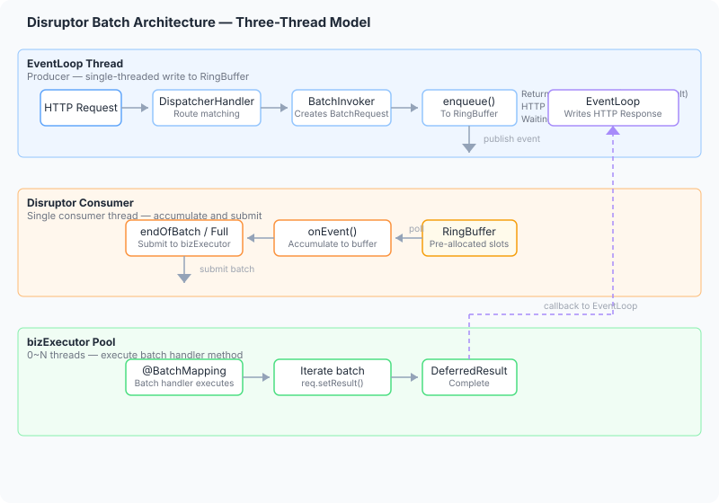

> English | [中文](../batch.md)

# Batch Processing Module

`spring-web-batch` transparently aggregates individual requests into batches, processed by a batch handler method at once. Ideal for IO-intensive scenarios (batch DB queries, batch RPC calls).

Built on **LMAX Disruptor** with lock-free ring buffer, backpressure strategies, wait strategies, and thread pool isolation.

---

## Table of Contents

- [Quick Start](#quick-start)
- [@BatchMapping Annotation](#batchmapping-annotation)
- [Architecture](#architecture)
  - [Batching Mechanism and Batch Size](#batching-mechanism-and-batch-size)
- [Observability](#observability)
- [Configuration Guide](#configuration-guide)
- [Important Notes](#important-notes)

---

## Quick Start

### 1. Add Dependency

```xml
<dependency>
    <groupId>io.github.springperf</groupId>
    <artifactId>spring-web-batch</artifactId>
    <version>${spring-web.version}</version>
</dependency>
```

`spring-web-batch` is declared as `<scope>provided</scope>` in `spring-boot-starter-web` — you must add it explicitly even when using the starter.

### 2. Write a Controller

**Step 1: Define the single-request endpoint**

Change the return type to `BatchRequest<R>` (a subclass of `DeferredResult`). The method body won't execute:

```java
@RestController
@RequestMapping("/api")
public class UserController {

    @GetMapping("/users/{id}")
    public BatchRequest<UserResp> getUser(@PathVariable Long id,
                                          @RequestParam(defaultValue = "zh") String lang) {
        // Method body won't execute — BatchInvoker handles it
        return null;
    }
}
```

**Step 2: Define a BatchRequest subclass**

Constructor parameter types must match the single-request method parameters **in order**:

```java
public class GetUserRequest extends BatchRequest<UserResp> {

    private final Long id;
    private final String lang;

    public GetUserRequest(Long id, String lang) {
        this.id = id;
        this.lang = lang;
    }

    public Long getId() { return id; }
    public String getLang() { return lang; }
}
```

**Step 3: Write the batch handler**

Add a `@BatchMapping` method in the same Controller:

```java
@RestController
@RequestMapping("/api")
public class UserController {

    // ... single-request endpoint

    @BatchMapping(method = "getUser")
    public void batchGetUser(List<GetUserRequest> batch) {
        Map<Long, UserResp> dbResult = userService.batchQuery(batch);
        for (GetUserRequest req : batch) {
            UserResp resp = dbResult.get(req.getId());
            req.setResult(resp != null ? resp : new UserResp());
        }
    }
}
```

- `@BatchMapping(method = "getUser")` links to the single-request endpoint
- The **only parameter** must be `List<? extends BatchRequest<?>>`
- Call `setResult()` on each request to complete its HTTP response

---

## @BatchMapping Annotation

```java
@Target(ElementType.METHOD)
@Retention(RetentionPolicy.RUNTIME)
@Documented
public @interface BatchMapping {

    int ringBufferSize() default 4096;
    WaitStrategy waitStrategy() default WaitStrategy.BLOCKING;
    Backpressure backpressure() default Backpressure.BLOCK;
    String method() default "";
    int maxBatchSize() default 100;
    int batchWindowMillis() default 5;
    int consumerSize() default -1;

    enum WaitStrategy { YIELDING, BLOCKING, SLEEPING, BUSY_SPIN }
    enum Backpressure { BLOCK, DROP, THROW }
}
```

### Parameters

| Parameter | Default | Description |
|-----------|---------|-------------|
| `ringBufferSize` | 4096 | Ring buffer capacity, auto-normalized to power of 2 |
| `waitStrategy` | BLOCKING | Consumer wait strategy (see table) |
| `backpressure` | BLOCK | Backpressure strategy (see table) |
| `method` | "" | Single-request method name to intercept; defaults to the batch method name |
| `maxBatchSize` | 100 | Max requests per batch before flushing |
| `batchWindowMillis` | 5 | Batching time window in milliseconds; 0 = explicitly disabled. **On by default**, so the batch size is guaranteed by the window instead of by momentary RingBuffer backlog; use 0 or 2~3ms for low traffic with very fast IO (< 5ms) - see [Batching Mechanism and Batch Size](#batching-mechanism-and-batch-size) |
| `consumerSize` | -1 | Max concurrent processing threads of the business pool (bizExecutor); defaults to available processors. The Disruptor consumer thread is separate and does **not** count against this cap. With virtual threads enabled (JDK 21+) only the executing threads become virtual and the cap is unchanged. Keep `waitStrategy=BLOCKING` in that mode: `BUSY_SPIN`/`YIELDING` never unmount a virtual thread, so they hold a carrier thread |

### Backpressure Strategies

| Strategy | Behavior | Client Response |
|----------|----------|-----------------|
| `BLOCK` | Producer thread blocks until space is available | Connection suspended |
| `DROP` | Request is dropped with `BatchOverflowException` set | **429 Too Many Requests** |
| `THROW` | `BatchOverflowException` thrown synchronously | **429 Too Many Requests** |

### Wait Strategies

| Strategy | Use Case | CPU | Latency |
|----------|----------|-----|---------|
| `BLOCKING` | Idle periods, CPU-conservative | Low | High |
| `YIELDING` | Low latency, medium throughput | Medium | Medium |
| `SLEEPING` | CPU-conservative with responsiveness | Low | Medium-high |
| `BUSY_SPIN` | Ultra-low latency, high throughput | High (busy-waits) | Low |

### Thread Model

Each `@BatchMapping` method gets its own Disruptor queue:

```
Dispatch thread (producer: `default` business pool; EventLoop when virtual threads are on)
    ↓ enqueue
RingBuffer
    ↓
Disruptor consumer (1 thread)
    ↓ accumulate → submit
bizExecutor pool (0 ~ consumerSize threads; virtual threads when enabled)
    ↓ execute
@BatchMapping method
```

- **Producer**: the dispatch thread enqueues via `BatchInvoker` — the `default` business pool by default (following `pool.default-execute-mode`); with virtual threads enabled (JDK 21+) it **switches to the EventLoop** (`BatchRegistry` clears the default pool to avoid one extra thread switch). Either way an enqueue is microsecond-scale and non-blocking, so no `@RunInPool` is needed
- **Consumer**: Single Disruptor consumer thread polls the ring buffer
- **Business pool**: 0 core threads, `SynchronousQueue`, `CallerRunsPolicy` — zero threads at idle, consumer self-executes at capacity (built-in backpressure). With `spring.threads.virtual.enabled=true` (JDK 21+) the executing threads become **virtual threads** (cap and backpressure semantics unchanged: `consumerSize` still applies), so blocking parks a virtual thread rather than a platform thread

### Batching Mechanism and Batch Size

**Everything this module buys you depends on batch size**: one batched IO replaces N single-row IOs, so the larger N is, the more IO is eliminated. The default 5ms window exists to guarantee the batch size; setting it explicitly to 0 drops the batch size back to the momentary RingBuffer backlog, where `maxBatchSize=100` rarely takes effect. The reason is how flushing is triggered:

`BufferingBatchHandler` submits each batch to bizExecutor via `executor.execute()` — **asynchronous, so IO runs on a business thread and never blocks the Disruptor consumer thread**. Handling one event is just appending to a buffer (nanoseconds), so the consumer almost always catches up with the empty queue; Disruptor's `endOfBatch` signal is set when no further events are available, so the consumer flushes after every single event.

> Put differently (**only when the window is explicitly disabled**): the batch size is not set by `maxBatchSize`, but by how many new events the producers publish while the consumer handles one event. In IO-dominated workloads that number is close to 1.

The only moment the consumer blocks is when bizExecutor is saturated and `CallerRunsPolicy` makes the consumer thread run the IO itself. Only then does the ring buffer back up and the batch size spike. This produces a counter-intuitive consequence: **`consumerSize` and batch size are in direct opposition** — more parallelism means faster consumption, less backlog, smaller batches.

| Config (100ms IO, concurrency 100, measured before the scheduler precision fix; shown for the mechanism) | Batch size | IO cost per request | QPS |
|---|---|---|---|
| `consumerSize=8` (sane parallelism) | 2.8 | 106.5ms → 38.2ms (2.8x) | 632 |
| `consumerSize=1` (trades parallelism away) | 35.2 | 106.5ms → 3.1ms (34x) | 458 |
| `consumerSize=8` + `batchWindowMillis=5` | 17.8 | 106.5ms → 6.1ms (17x) | 611 |

**The time window is on by default.** With `batchWindowMillis > 0` (default 5ms), the first event of a batch starts the window and accumulation continues until either `maxBatchSize` is reached or the window expires. The batch size is then guaranteed by configuration instead of by accidental pool saturation, and `consumerSize` is free to do its real job — reusing cores (core count is enough, do not over-provision) — without the two fighting each other. Setting it explicitly to 0 returns to the `endOfBatch` path above.

The cost is up to one extra window of waiting per batch, i.e. the per-request latency upper bound is roughly
the window value. The 5ms default comes from a parameter sweep run after the window scheduler precision fix
(closed model, concurrency 100, `consumerSize=8`, `maxBatchSize=100`, downstream IO 5 / 10 / 20 / 50ms):
throughput was **1.30x / 2.14x / 1.71x / 1.54x** of the no-window baseline, batch size reached 64~100,
IO calls dropped 4~5x, and p50 / p99 fell with it. At low load (concurrency 1~4) the waiting is pure cost,
about +0~6ms of mean latency (concurrency / QPS).

| IO latency / load | Suggested window | Rationale |
|---|---|---|
| Typical DB / RPC (>= 5ms), medium-to-high concurrency | 5 (default) | The gain is already fully realised; no tuning needed |
| Low traffic + very fast IO (< 5ms) | 0 or 2~3ms | Waiting dominates; measured below the no-window baseline at concurrency 4 / 5ms IO |
| Slow IO (> 50ms) | 5, or raise after benchmarking | 5ms already fills `maxBatchSize`; a larger window has no stable gain, so benchmark first |
| Ultra-low latency | 0 (explicitly off) | Even a lone request waits for the window to expire |

> **About the 10ms setting**: on some platforms (for example `Object.wait(10)` on Windows) a 10ms window is
> quantised to about 15ms and measured clearly worse than 5ms (0.93x vs 2.14x at 10ms IO). If a larger window
> is really needed, jump to 25ms and benchmark; do not stop at 10ms.

Setting `batchWindowMillis` explicitly to 0 makes startup log one WARN per queue with the window disabled
(queue names listed): the batch size then depends on momentary RingBuffer backlog and `maxBatchSize` is rarely
reached. Queues that leave the attribute undeclared use the default 5ms and are no longer warned about; write
`batchWindowMillis = 0` explicitly if you need the old behaviour.

#### Gains and Costs, Quantified

The numbers below come from the parameter sweep after the window scheduler precision fix (closed model, JDK 17,
`consumerSize=8`, `maxBatchSize=100`, concurrency 1 / 4 / 100, downstream IO 5 / 10 / 20 / 50ms). Absolute
values depend on the machine and load model — read the relative trends.

**High concurrency (100) — the 5ms default consistently beats no window**:

| IO latency | W=0 QPS | W=3 | W=5 (default) | W=10 | W=25 | W=5 batch size / IO calls |
|---|---|---|---|---|---|---|
| 5ms | 3176 | 1.32x | **1.30x** | — | — | 64.1 / 194 (W0: 11.4 / 837) |
| 10ms | 3001 | 1.44x | **2.14x** | 0.93x | — | 100 / 193 (W0: 9.0 / 1002) |
| 20ms | 1693 | 1.57x | **1.71x** | 1.11x | — | 68.0 / 128 (W0: 10.0 / 510) |
| 50ms | 1061 | 1.37x | **1.54x** | 1.23x | 1.51x | 100 / 49 (W0: 12.3 / 258) |

The gain is IO elimination: 4~5x fewer IO calls and lower p50 / p99 (20ms p99 206 → 48ms). W=3 and W=5 are
within baseline noise of each other, but W=5 wins at 10 / 20 / 50ms, hence the default. W=10 falls back
sharply, mostly because of platform timer quantisation.

**Low concurrency (1~4) — waiting is pure cost**: with sparse traffic the first request schedules the window
task and nothing arrives to share it, so it waits for the full window. At concurrency 1 / 10ms IO, W=5 reached
about 0.84x of the no-window QPS with p50 16 → 30ms (histogram buckets are ~16ms wide, so this is not the
same measure as mean latency); at concurrency 4 / 5ms IO about 0.76x. Slow IO can still break even or win
slightly (concurrency 4 / 50ms IO: 1.05x). Use 0 or 2~3ms for these workloads.

#### So, Should You Keep the Default Window?

| Goal | Recommendation |
|------|----------------|
| Reduce database / downstream load | **Keep the default 5ms.** Fewer IO calls regardless of IO latency |
| Raise throughput at medium/high concurrency, IO >= 10ms | **Keep the default 5ms**, where the gain is largest |
| Low traffic + very fast IO (< 5ms) | Set 0 or 2~3ms explicitly |
| Ultra-low latency | Set 0 explicitly |
| Raising the window above 10ms | Benchmark first; 5ms usually already fills `maxBatchSize`, and 10ms is quantised on some platforms |

---

## Architecture

### Request Flow

<p align="center">

</p>

### Core Components

| Class | Responsibility |
|-------|---------------|
| `BatchRequest<R>` | Extends `DeferredResult<R>`, user-extended request base class |
| `@BatchMapping` | Marks batch handler methods, links to single-request method |
| `BatchRegistry` | Manages ring buffer lifecycle, installs `BatchInvoker` |
| `BatchInvoker` | Replaces controller method invocation, creates and enqueues `BatchRequest` |
| `DisruptorQueue` | Wraps LMAX Disruptor, provides enqueue/backpressure/shutdown |
| `BufferingBatchHandler` | Disruptor consumer, accumulates and submits batches |

---

### Why Disruptor

- **Lock-free concurrency**: `ProducerType.MULTI` supports multiple EventLoop threads enqueuing concurrently with no lock contention
- **Pre-allocated event slots**: `BatchEvent` instances are pre-created in the RingBuffer, reducing GC pressure
- **endOfBatch signal**: Disruptor notifies the consumer when a batch of events is complete, minimizing batching latency
- **Natural backpressure**: When the RingBuffer is full, the producer blocks → EventLoop backpressures to the TCP layer

---

## Observability

### Metrics

`BatchMetrics` is the metrics SPI and the default implementation is `NoOpBatchMetrics` (all no-op). When
`io.micrometer.core.instrument.MeterRegistry` is on the classpath (e.g. via `spring-boot-starter-actuator`), the
**starter** (the `MicrometerBatchMetricsConfiguration` nested in `SpringWebBatchAutoConfiguration`) registers
`MicrometerBatchMetrics` and injects it via `BatchRegistry#setMetrics(...)`, producing:

| Metric | Type | Tag | Description |
|--------|------|-----|-------------|
| `batch.enqueue.total` | Counter | `queue` | Total enqueue attempts |
| `batch.enqueue.rejected` | Counter | `queue` | Enqueues rejected during shutdown (the unsuccessful part of `total`; DROP / THROW overflows are counted in `dropped` / `overflow` instead) |
| `batch.enqueue.dropped` | Counter | `queue` | Requests dropped by backpressure |
| `batch.enqueue.overflow` | Counter | `queue` | Overflow exceptions thrown |
| `batch.process.duration` | Timer | `queue` + `outcome=success/failure` | Batch processing duration (success/failure kept apart so failed batches do not skew quantiles) |
| `batch.process.batch.size` | DistributionSummary | `queue` | Batch size distribution |
| `batch.process.requests` | Counter | `queue` | Requests completed via batch (only batches whose method returned normally) |
| `batch.queue.remaining` | Gauge | `queue` | Ring buffer remaining capacity (sampling schedule below) |
| `batch.queue.capacity` | Gauge | `queue` | Ring buffer total capacity |

All metrics carry a `queue` tag valued `batch:<ClassName>.<methodName>` (generated by `BatchScanner`).

> **When the capacity gauges are sampled**: once at queue startup (Gauge registration lands in the startup phase, never on the request path), then once after every batch completes; additionally, a failed DROP / THROW enqueue reports immediately.
> Sampling needs no extra thread and adds nothing to the normal enqueue path. The value is a water mark rather than a live reading — when batches stop being produced it stays at the last sample.

### Monitoring Tips

- **`batch.queue.remaining`**: alert when below 10% of buffer size — backpressure is near limit
- **`batch.process.duration`**: watch p99 (split by `outcome`); a sustained increase indicates worker pool saturation
- **`batch.enqueue.dropped`** / **`batch.enqueue.overflow`**: drops indicate insufficient buffer or consumer speed; adjust `ringBufferSize` or `consumerSize`

---

## Configuration Guide

### Global Defaults (`springperf.batch.*`)

When several queues need the same tuning, do not edit every annotation — set the global keys instead and leave the annotations at their defaults:

| Key | Default | Annotation attribute | Notes |
|------|--------|------|------|
| `springperf.batch.window-millis` | `5` | `batchWindowMillis` | Accumulation window in ms, `0` disables it globally |
| `springperf.batch.max-batch-size` | `100` | `maxBatchSize` | Max requests per batch |
| `springperf.batch.consumer-size` | `-1` | `consumerSize` | bizExecutor concurrency cap, `-1` = CPU cores |
| `springperf.batch.ring-buffer-size` | `4096` | `ringBufferSize` | Non-power-of-two values are normalised by the queue with a warning |
| `springperf.batch.wait-strategy` | `BLOCKING` | `waitStrategy` | Case-insensitive; `busy-spin` and `BUSY_SPIN` both work |
| `springperf.batch.backpressure` | `BLOCK` | `backpressure` | Same as above |

```properties
# Low traffic + fast IO: 3ms window on every queue, no annotation edits
springperf.batch.window-millis=3
# Many queues: keep the total concurrency within the core count
springperf.batch.consumer-size=4
```

Precedence: **explicit annotation value > global key > annotation built-in default**. A global key only applies to queues that keep the default.

Boundaries worth knowing:

- **Startup only**: queues are built once while `@BatchMapping` methods are scanned; changing a key later does not rebuild them (same as `pool.core-pool-size`).
- **Writing the built-in default is the same as not writing it**: Java annotations cannot distinguish "undeclared" from "explicitly set to the default" at runtime, so with `window-millis=3`, `@BatchMapping(batchWindowMillis = 5)` still resolves to 3. Use a different value to override locally (`0` to disable the window, or `8`).
- **Invalid values fail startup** with the key name and the allowed values (`wait-strategy` reports `[YIELDING, BLOCKING, SLEEPING, BUSY_SPIN]`); they never fall back silently.
- **Visibility**: one line at startup shows the effective values, e.g. `Batch global defaults: windowMillis=3, ... (configured: springperf.batch.window-millis)`; `configured: none, all built-in` means nothing was set.

### Tuning Recommendations

| Scenario | Recommended Configuration | Notes |
|----------|--------------------------|-------|
| High throughput, latency-tolerant | `ringBufferSize=16384, maxBatchSize=500` (keep the default 5ms window) | Larger buffer, larger batches; the default window already lets the batch size reach `maxBatchSize` |
| Latency-sensitive | `ringBufferSize=1024, maxBatchSize=50, waitStrategy=BUSY_SPIN, batchWindowMillis=0` | Disable the window to avoid waiting; small buffer, aggressive wait. **With `spring.threads.virtual.enabled` use `BLOCKING` instead**: `BUSY_SPIN`/`YIELDING` never unmount a virtual thread and hold a carrier |
| Resource-constrained (1c1g) | `ringBufferSize=4096, consumerSize=1` | Single consumer thread. Batch size grows naturally (slow consumption → backlog); set `batchWindowMillis=0` explicitly to skip the scheduler thread |
| Batch DB queries | `maxBatchSize=200, batchWindowMillis=5` | Most DB IN queries perform best at ~200; the window drives the batch size toward 200 |
| Batch RPC calls | `maxBatchSize=50, consumerSize=4` (keep the default 5ms window) | Parallel RPC, smaller batches; 5ms already fills the batch and a 10ms window is quantised on some platforms |
| Slow IO (>50ms) | Keep the default 5ms window (try 25ms only after benchmarking) | Measured at 50ms IO: 5ms reaches 1.54x throughput with a full batch of 100, while 25ms measures 1.51~1.57x across runs — within noise of the default |
| Reduce downstream load (IO <20ms) | Keep the default 5ms window | Measured 4~5x fewer IO calls and higher throughput at the same time (2.14x at 10ms IO), easing database pressure |

### Consumer Thread Pool

`consumerSize` controls max concurrent processing threads. Default `-1` = available processors.

The pool uses `SynchronousQueue` + `CallerRunsPolicy`:
- Zero threads at idle
- Consumer self-executes at capacity (backpressure)
- No manual core thread tuning needed

**This value exists to reuse cores — the core count is enough, do not over-provision it.** Raising it buys nothing beyond a higher batch-processing throughput ceiling, and it actively *shrinks* the batch size (faster consumption → less backlog), weakening the very IO elimination the module is for. When you need bigger batches, tune `batchWindowMillis` (5ms by default) rather than raising `consumerSize`.

> **Every `@BatchMapping` method owns a dedicated bizExecutor**: worst-case concurrency across N queues is N × `consumerSize`. The default (core count) is designed for a single queue — with multiple queues set `consumerSize` explicitly so the sum stays within the core count; startup warns when it does not.

> **Virtual threads**: with `spring.threads.virtual.enabled=true` (JDK 21+) the pool's **threads** become virtual (thread names `batch-virtual-*`) — `consumerSize`, `SynchronousQueue` and `CallerRunsPolicy` all keep their semantics, so a saturated pool still makes the consumer thread execute inline as backpressure; blocking IO inside a batch method no longer occupies a platform thread.

---

## Important Notes

### Method Body Replacement

When `@BatchMapping` is installed, the linked `@RequestMapping` method body **will NOT execute**. `BatchInvoker` directly constructs `BatchRequest` instances and enqueues them. Any logic in the single-request method (logging, validation, etc.) is skipped — handle these in the `@BatchMapping` method instead.

### The Batch Method Must Complete Every Request

After the batch method returns, the framework scans the batch for requests still not completed, fails them with `IllegalStateException` (client sees 500) and logs a single WARN with the queue name and "completed / total" counts.

This is a safety net, not the normal path: a forgotten `setResult` (e.g. a missing key in a lookup map) would otherwise leave those requests hanging until the 30-second timeout, with neither a valid response nor any diagnostic.

> Consequently, **do not hand `setResult` to another thread and return immediately** — the contract is that the batch method completes every request before it returns.

### Timeout

`BatchRequest` defaults to a 30-second timeout. The `DeferredResult` triggers on timeout. Use the parameterized constructor for custom timeouts:

```java
public class GetUserRequest extends BatchRequest<UserResp> {
    public GetUserRequest(Long id, String lang) {
        super(10000L); // 10-second timeout
        this.id = id;
        this.lang = lang;
    }
}
```

### Error Handling

| Scenario | Handling | Client Response |
|----------|----------|-----------------|
| RingBuffer full, backpressure BLOCK | Producer thread blocks | Connection suspended |
| RingBuffer full, backpressure DROP | `BatchOverflowException` set on request | 429 |
| RingBuffer full, backpressure THROW | Synchronous exception thrown | 429 |
| Batch processing exception | `setError(e)` on all pending requests | 500 |
| Batch method returns without calling `setResult` | Framework fails the remaining requests with `IllegalStateException` and logs a WARN | 500 |
| Batch rejected because the pool is already shut down | Each request fails with `RejectedExecutionException`; the batch is never dropped silently | 500 |
| Request timeout | `DeferredResult` timeout callback | 503 |

### Shutdown

`shutdown()` runs in three steps, each with a bound:

| Step | Behaviour | Bound |
|------|-----------|-------|
| 1. Drain ring buffer | Wait for the consumer to process published events | **5 seconds**; on timeout `halt()` — unconsumed requests fall back to the `DeferredResult` timeout |
| 2. Flush residual buffer | `flushRemaining()` submits the accumulated batch | When the pool is saturated, `CallerRunsPolicy` makes the shutdown thread execute the batch inline |
| 3. Await in-flight batches | `awaitTermination` | 30 seconds, then `shutdownNow()` |

> When shutdown is slow, suspect the batch method itself rather than Disruptor: both step 2 and step 3 scale with its duration.

### Debugging

- Enable DEBUG logging for `io.springperf.web.batch` to observe enqueue and batch processing
- Use the Micrometer metrics (registered by the starter when `MeterRegistry` is on the classpath) to monitor queue depth and processing latency
- Adjust `ringBufferSize` and `consumerSize` based on observed metrics
