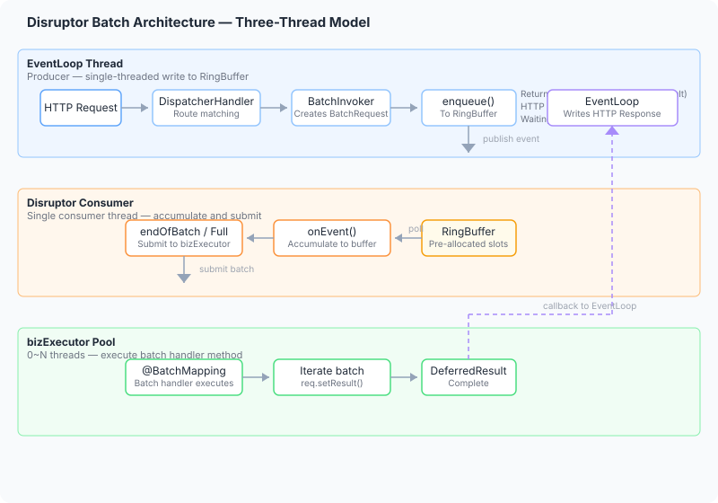

> English | [中文](../batch.md)

# Batch Processing Module

`spring-web-batch` transparently aggregates individual requests into batches, processed by a batch handler method at once. Ideal for IO-intensive scenarios (batch DB queries, batch RPC calls).

Built on **LMAX Disruptor** with lock-free ring buffer, backpressure strategies, wait strategies, and thread pool isolation.

---

## Table of Contents

- [Quick Start](#quick-start)
- [@BatchMapping Annotation](#batchmapping-annotation)
- [Architecture](#architecture)
  - [Batching Mechanism and Batch Size](#batching-mechanism-and-batch-size)
- [Observability](#observability)
- [Configuration Guide](#configuration-guide)
- [Important Notes](#important-notes)

---

## Quick Start

### 1. Add Dependency

```xml
<dependency>
    <groupId>io.github.springperf</groupId>
    <artifactId>spring-web-batch</artifactId>
    <version>${spring-web.version}</version>
</dependency>
```

`spring-web-batch` is declared as `<scope>provided</scope>` in `spring-boot-starter-web` — you must add it explicitly even when using the starter.

### 2. Write a Controller

**Step 1: Define the single-request endpoint**

Change the return type to `BatchRequest<R>` (a subclass of `DeferredResult`). The method body won't execute:

```java
@RestController
@RequestMapping("/api")
public class UserController {

    @GetMapping("/users/{id}")
    public BatchRequest<UserResp> getUser(@PathVariable Long id,
                                          @RequestParam(defaultValue = "zh") String lang) {
        // Method body won't execute — BatchInvoker handles it
        return null;
    }
}
```

**Step 2: Define a BatchRequest subclass**

Constructor parameter types must match the single-request method parameters **in order**:

```java
public class GetUserRequest extends BatchRequest<UserResp> {

    private final Long id;
    private final String lang;

    public GetUserRequest(Long id, String lang) {
        this.id = id;
        this.lang = lang;
    }

    public Long getId() { return id; }
    public String getLang() { return lang; }
}
```

**Step 3: Write the batch handler**

Add a `@BatchMapping` method in the same Controller:

```java
@RestController
@RequestMapping("/api")
public class UserController {

    // ... single-request endpoint

    @BatchMapping(method = "getUser")
    public void batchGetUser(List<GetUserRequest> batch) {
        Map<Long, UserResp> dbResult = userService.batchQuery(batch);
        for (GetUserRequest req : batch) {
            UserResp resp = dbResult.get(req.getId());
            req.setResult(resp != null ? resp : new UserResp());
        }
    }
}
```

- `@BatchMapping(method = "getUser")` links to the single-request endpoint
- The **only parameter** must be `List<? extends BatchRequest<?>>`
- Call `setResult()` on each request to complete its HTTP response

---

## @BatchMapping Annotation

```java
@Target(ElementType.METHOD)
@Retention(RetentionPolicy.RUNTIME)
@Documented
public @interface BatchMapping {

    int ringBufferSize() default 4096;
    WaitStrategy waitStrategy() default WaitStrategy.BLOCKING;
    Backpressure backpressure() default Backpressure.BLOCK;
    String method() default "";
    int maxBatchSize() default 100;
    int batchWindowMillis() default 0;
    int consumerSize() default -1;

    enum WaitStrategy { YIELDING, BLOCKING, SLEEPING, BUSY_SPIN }
    enum Backpressure { BLOCK, DROP, THROW }
}
```

### Parameters

| Parameter | Default | Description |
|-----------|---------|-------------|
| `ringBufferSize` | 4096 | Ring buffer capacity, auto-normalized to power of 2 |
| `waitStrategy` | BLOCKING | Consumer wait strategy (see table) |
| `backpressure` | BLOCK | Backpressure strategy (see table) |
| `method` | "" | Single-request method name to intercept; defaults to the batch method name |
| `maxBatchSize` | 100 | Max requests per batch before flushing |
| `batchWindowMillis` | 0 | Batching time window in milliseconds; 0 = disabled. **Decides whether the batch size can actually reach `maxBatchSize`; the slower the IO, the more you want it on** - see [Batching Mechanism and Batch Size](#batching-mechanism-and-batch-size) |
| `consumerSize` | -1 | Max concurrent processing threads of the business pool (bizExecutor); defaults to available processors. The Disruptor consumer thread is separate and does **not** count against this cap. With virtual threads enabled (JDK 21+) only the executing threads become virtual and the cap is unchanged. Keep `waitStrategy=BLOCKING` in that mode: `BUSY_SPIN`/`YIELDING` never unmount a virtual thread, so they hold a carrier thread |

### Backpressure Strategies

| Strategy | Behavior | Client Response |
|----------|----------|-----------------|
| `BLOCK` | Producer thread blocks until space is available | Connection suspended |
| `DROP` | Request is dropped with `BatchOverflowException` set | **429 Too Many Requests** |
| `THROW` | `BatchOverflowException` thrown synchronously | **429 Too Many Requests** |

### Wait Strategies

| Strategy | Use Case | CPU | Latency |
|----------|----------|-----|---------|
| `BLOCKING` | Idle periods, CPU-conservative | Low | High |
| `YIELDING` | Low latency, medium throughput | Medium | Medium |
| `SLEEPING` | CPU-conservative with responsiveness | Low | Medium-high |
| `BUSY_SPIN` | Ultra-low latency, high throughput | High (busy-waits) | Low |

### Thread Model

Each `@BatchMapping` method gets its own Disruptor queue:

```
Dispatch thread (producer: `default` business pool; EventLoop when virtual threads are on)
    ↓ enqueue
RingBuffer
    ↓
Disruptor consumer (1 thread)
    ↓ accumulate → submit
bizExecutor pool (0 ~ consumerSize threads; virtual threads when enabled)
    ↓ execute
@BatchMapping method
```

- **Producer**: the dispatch thread enqueues via `BatchInvoker` — the `default` business pool by default (following `pool.default-execute-mode`); with virtual threads enabled (JDK 21+) it **switches to the EventLoop** (`BatchRegistry` clears the default pool to avoid one extra thread switch). Either way an enqueue is microsecond-scale and non-blocking, so no `@RunInPool` is needed
- **Consumer**: Single Disruptor consumer thread polls the ring buffer
- **Business pool**: 0 core threads, `SynchronousQueue`, `CallerRunsPolicy` — zero threads at idle, consumer self-executes at capacity (built-in backpressure). With `spring.threads.virtual.enabled=true` (JDK 21+) the executing threads become **virtual threads** (cap and backpressure semantics unchanged: `consumerSize` still applies), so blocking parks a virtual thread rather than a platform thread

### Batching Mechanism and Batch Size

**Everything this module buys you depends on batch size**: one batched IO replaces N single-row IOs, so the larger N is, the more IO is eliminated. But under the default configuration the batch size sits at 1~3 and `maxBatchSize=100` never takes effect. The reason is how flushing is triggered:

`BufferingBatchHandler` submits each batch to bizExecutor via `executor.execute()` — **asynchronous, so IO runs on a business thread and never blocks the Disruptor consumer thread**. Handling one event is just appending to a buffer (nanoseconds), so the consumer almost always catches up with the empty queue; Disruptor's `endOfBatch` signal is set when no further events are available, so the consumer flushes after every single event.

> Put differently: **the batch size is not set by `maxBatchSize`, but by how many new events the producers publish while the consumer handles one event.** In IO-dominated workloads that number is close to 1.

The only moment the consumer blocks is when bizExecutor is saturated and `CallerRunsPolicy` makes the consumer thread run the IO itself. Only then does the ring buffer back up and the batch size spike. This produces a counter-intuitive consequence: **`consumerSize` and batch size are in direct opposition** — more parallelism means faster consumption, less backlog, smaller batches.

| Config (100ms IO, concurrency 100, measured) | Batch size | IO cost per request | QPS |
|---|---|---|---|
| `consumerSize=8` (sane parallelism) | 2.8 | 106.5ms → 38.2ms (2.8x) | 632 |
| `consumerSize=1` (trades parallelism away) | 35.2 | 106.5ms → 3.1ms (34x) | 458 |
| `consumerSize=8` + `batchWindowMillis=5` | 17.8 | 106.5ms → 6.1ms (17x) | 611 |

**The fix is the time window.** With `batchWindowMillis > 0`, the first event of a batch starts the window and accumulation continues until either `maxBatchSize` is reached or the window expires. The batch size is then guaranteed by configuration instead of by accidental pool saturation, and `consumerSize` is free to do its real job — reusing cores (core count is enough, do not over-provision) — without the two fighting each other.

The cost is up to one extra window of waiting per batch, i.e. the per-request latency upper bound is roughly the window value. Recommended values:

| IO latency | Suggested window | Rationale |
|------------|------------------|-----------|
| < 5ms | 0 (off) | Batching gain does not cover the wait |
| 5 ~ 20ms | 1/4 of IO latency | Gain outweighs the wait |
| > 20ms | 1/2 of IO latency | Slower IO justifies waiting longer |

> Measured counter-example: 10ms IO with a 5ms window produced *lower* throughput than no window at all — the wait consumed half of the IO time. The window should be well below the IO latency.

#### Gains and Costs, Quantified

Those recommendations come from a parameter sweep (closed model, concurrency 100, `consumerSize=8`, `maxBatchSize=100`). Gains and costs must be read separately — they do not always hold together:

**Gain — always holds, independent of IO latency**: IO call count drops 3~10x and IO cost per request drops 4~10x. That *is* the IO elimination, and it relieves the database/downstream even when throughput does not move.

**Throughput — only cashes out when IO is slow enough**:

| IO latency | Best window | Throughput | IO cost per request |
|------------|-------------|------------|---------------------|
| 50ms | 25ms (1/2) | **+15% ~ +45%** | 6.6ms → 0.64ms (10x) |
| 20ms | 10ms (1/2) | -22% ~ +3% (flat) | 2.6ms → 0.74ms (3.5x) |

The reason: for a window to raise throughput, the consumer side (bizExecutor) has to be the bottleneck. At 20ms IO with `consumerSize=8` there is already 400 batches/sec of headroom, so the bottleneck is elsewhere and the window only removes IO calls.

**Latency — counter-intuitively it *drops* for slow IO**. In the 50ms case p50 fell from ~110ms to ~79ms (**-30ms**): without a window 100 concurrent requests split into ~10 batches and a request queues behind the earlier ones; with a window one batch covers them and latency ≈ 25ms window + 50ms IO. **Removing queueing rounds beats the extra window wait.**

**Loss zone**: as the window approaches the IO latency, the batch cycle becomes window + IO and every arriving request piles up, producing a tidal pattern with occasional p99 spikes (one run hit 492ms). The window should not reach the IO latency itself.

#### So, Should You Turn It On?

| Goal | Recommendation |
|------|----------------|
| Reduce database / downstream load | **Yes.** The gain is certain regardless of IO latency |
| Raise throughput, IO > 20ms | **Yes**, at 1/2 of the IO latency |
| Raise throughput, IO < 20ms | Little to gain — check whether the bottleneck is really here |
| Ultra-low latency | Careful. At fast IO p50 may not improve at all |

---

## Architecture

### Request Flow

<p align="center">

</p>

### Core Components

| Class | Responsibility |
|-------|---------------|
| `BatchRequest<R>` | Extends `DeferredResult<R>`, user-extended request base class |
| `@BatchMapping` | Marks batch handler methods, links to single-request method |
| `BatchRegistry` | Manages ring buffer lifecycle, installs `BatchInvoker` |
| `BatchInvoker` | Replaces controller method invocation, creates and enqueues `BatchRequest` |
| `DisruptorQueue` | Wraps LMAX Disruptor, provides enqueue/backpressure/shutdown |
| `BufferingBatchHandler` | Disruptor consumer, accumulates and submits batches |

---

### Why Disruptor

- **Lock-free concurrency**: `ProducerType.MULTI` supports multiple EventLoop threads enqueuing concurrently with no lock contention
- **Pre-allocated event slots**: `BatchEvent` instances are pre-created in the RingBuffer, reducing GC pressure
- **endOfBatch signal**: Disruptor notifies the consumer when a batch of events is complete, minimizing batching latency
- **Natural backpressure**: When the RingBuffer is full, the producer blocks → EventLoop backpressures to the TCP layer

---

## Observability

### Metrics

`BatchMetrics` is the metrics SPI and the default implementation is `NoOpBatchMetrics` (all no-op). When
`io.micrometer.core.instrument.MeterRegistry` is on the classpath (e.g. via `spring-boot-starter-actuator`), the
**starter** (the `MicrometerBatchMetricsConfiguration` nested in `SpringWebBatchAutoConfiguration`) registers
`MicrometerBatchMetrics` and injects it via `BatchRegistry#setMetrics(...)`, producing:

| Metric | Type | Tag | Description |
|--------|------|-----|-------------|
| `batch.enqueue.total` | Counter | `queue` | Total enqueue attempts |
| `batch.enqueue.rejected` | Counter | `queue` | Enqueue attempts that failed (the unsuccessful part of `total`) |
| `batch.enqueue.dropped` | Counter | `queue` | Requests dropped by backpressure |
| `batch.enqueue.overflow` | Counter | `queue` | Overflow exceptions thrown |
| `batch.process.duration` | Timer | `queue` + `outcome=success/failure` | Batch processing duration (success/failure kept apart so failed batches do not skew quantiles) |
| `batch.process.batch.size` | DistributionSummary | `queue` | Batch size distribution |
| `batch.process.requests` | Counter | `queue` | Requests completed via batch |
| `batch.queue.remaining` | Gauge | `queue` | Ring buffer remaining capacity |
| `batch.queue.capacity` | Gauge | `queue` | Ring buffer total capacity |

All metrics carry a `queue` tag valued `batch:<ClassName>.<methodName>` (generated by `BatchScanner`).

### Monitoring Tips

- **`batch.queue.remaining`**: alert when below 10% of buffer size — backpressure is near limit
- **`batch.process.duration`**: watch p99 (split by `outcome`); a sustained increase indicates worker pool saturation
- **`batch.enqueue.dropped`** / **`batch.enqueue.overflow`**: drops indicate insufficient buffer or consumer speed; adjust `ringBufferSize` or `consumerSize`

---

## Configuration Guide

### Tuning Recommendations

| Scenario | Recommended Configuration | Notes |
|----------|--------------------------|-------|
| High throughput, latency-tolerant | `ringBufferSize=16384, maxBatchSize=500, batchWindowMillis=10` | Larger buffer, larger batches; the window makes the batch size actually reach `maxBatchSize` |
| Latency-sensitive | `ringBufferSize=1024, maxBatchSize=50, waitStrategy=BUSY_SPIN` | Small buffer, aggressive wait. **With `spring.threads.virtual.enabled` use `BLOCKING` instead**: `BUSY_SPIN`/`YIELDING` never unmount a virtual thread and hold a carrier |
| Resource-constrained (1c1g) | `ringBufferSize=4096, consumerSize=1` | Single consumer thread. Batch size grows naturally (slow consumption → backlog), so no window is needed |
| Batch DB queries | `maxBatchSize=200, batchWindowMillis=5` | Most DB IN queries perform best at ~200; the window drives the batch size toward 200 |
| Batch RPC calls | `maxBatchSize=50, consumerSize=4, batchWindowMillis=10` | Parallel RPC, smaller batches; window at 1/4~1/2 of the RPC latency |
| Slow IO (>50ms) | `batchWindowMillis=25` | The slower the IO, the more waiting pays off — measured +15~45% throughput, ~30ms lower p50, 10x less IO cost per request |
| Reduce downstream load (IO <20ms) | `batchWindowMillis=5` | Throughput may not move, but IO calls certainly drop 3x+, easing database pressure |

### Consumer Thread Pool

`consumerSize` controls max concurrent processing threads. Default `-1` = available processors.

The pool uses `SynchronousQueue` + `CallerRunsPolicy`:
- Zero threads at idle
- Consumer self-executes at capacity (backpressure)
- No manual core thread tuning needed

**This value exists to reuse cores — the core count is enough, do not over-provision it.** Raising it buys nothing beyond a higher batch-processing throughput ceiling, and it actively *shrinks* the batch size (faster consumption → less backlog), weakening the very IO elimination the module is for. When you need bigger batches, turn on `batchWindowMillis` rather than raising `consumerSize`.

> **Virtual threads**: with `spring.threads.virtual.enabled=true` (JDK 21+) the pool's **threads** become virtual (thread names `batch-virtual-*`) — `consumerSize`, `SynchronousQueue` and `CallerRunsPolicy` all keep their semantics, so a saturated pool still makes the consumer thread execute inline as backpressure; blocking IO inside a batch method no longer occupies a platform thread.

---

## Important Notes

### Method Body Replacement

When `@BatchMapping` is installed, the linked `@RequestMapping` method body **will NOT execute**. `BatchInvoker` directly constructs `BatchRequest` instances and enqueues them. Any logic in the single-request method (logging, validation, etc.) is skipped — handle these in the `@BatchMapping` method instead.

### Timeout

`BatchRequest` defaults to a 30-second timeout. The `DeferredResult` triggers on timeout. Use the parameterized constructor for custom timeouts:

```java
public class GetUserRequest extends BatchRequest<UserResp> {
    public GetUserRequest(Long id, String lang) {
        super(10000L); // 10-second timeout
        this.id = id;
        this.lang = lang;
    }
}
```

### Error Handling

| Scenario | Handling | Client Response |
|----------|----------|-----------------|
| RingBuffer full, backpressure BLOCK | Producer thread blocks | Connection suspended |
| RingBuffer full, backpressure DROP | `BatchOverflowException` set on request | 429 |
| RingBuffer full, backpressure THROW | Synchronous exception thrown | 429 |
| Batch processing exception | `setError(e)` on all pending requests | 500 |
| Request timeout | `DeferredResult` timeout callback | 503 |

### Debugging

- Enable DEBUG logging for `io.springperf.web.batch` to observe enqueue and batch processing
- Use the Micrometer metrics (registered by the starter when `MeterRegistry` is on the classpath) to monitor queue depth and processing latency
- Adjust `ringBufferSize` and `consumerSize` based on observed metrics
